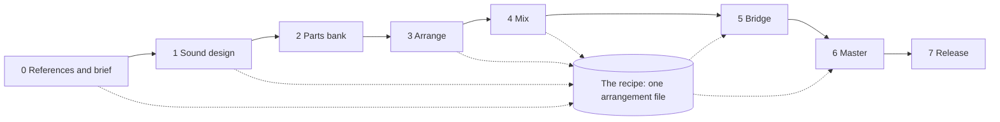

# The production map: from references to release (design)

A map of what zpkt builds for making a track, written 12 November 2026 at the end of the day the HW002 arranger,
transitions page and both mix pages were built (PRs #139-#141). It says which steps exist, which are partly there,
and which are missing, so the next pieces of work can be chosen against the whole. The same map as a page:
[`production-map.html`](production-map.html).

## The principle

Anthony: "Mixing should be another app that stores structure. All of this accumulates into a recipe for the mastering
step to actually run in ableton live."

Every step writes **structure**, not audio: which loops play where, which transition lands at which change, each
channel's gain, pan and cuts, the devices kept from a grid of renders. The structure adds up to one **recipe**, kept in
the arrangement file (`regions`, `transitions`, `mix`, `mix2`, later `automation`). The master step runs the recipe in
Ableton Live; until then, nothing a page plays is the track itself.

## Three ways to hear a change

Anthony named them: "we have had two modes: offline DAW audio and online browser audio, and normal production is
online DAW audio, this is a new flow which is online small-batch DAW audio."

| Mode | What happens | Where it is used |
|---|---|---|
| Offline DAW audio | Live renders a state; a page plays the file | Sound design, parts bank, bridge, master |
| Online browser audio | Parts rendered in Live are started together in the browser; mix 1 adds gain, pan and cuts (a named exception in `contrib/docs/sound.md`) | Arrange, transitions, mix 1 |
| Online small-batch DAW audio | Anthony picks the ranges to hear; Live renders a coarse grid of them; he plays the grid on a page | Mix 2, and automation next |

The sound rule (`contrib/docs/sound.md`) holds across all three: the browser plays renders and makes no sound of its
own, apart from the exceptions named there.

## The map

A track's place is its lowest unfinished stage (as in `contrib/docs/workflow.md`). HW002 is at stage 4: arranged with
transitions, mid-way through mix 1.

| # | Stage | Writes | Built | Partly built | Missing |
|---|---|---|---|---|---|
| 0 | References and brief | `brief` | Reference analysis (wav-timeline: aligned drops, tempo, spectrogram and EQ columns, named regions) | | **The brief**: tempo, key, length, the break-to-drop shape and the reference set as one first card the later steps read. Today it is spread through scripts such as `contrib/arranger/shorts.py`. |
| 1 | Sound design | sounds in the set | Synth design in small steps (Anthony's separate apps); transition sounds (`contrib/arranger/fxset.py`) | Audio collage (`prototypes/audio-browser`, the Rummage) | **Drums** (hats, percussion, grooves); **kick and rumble** |
| 2 | Parts bank | `loops.json` | | Bounce and cut (`contrib/arranger/bounce.py`, `mine.py`), wired to the HW002 set | A general parts bank for any track |
| 3 | Arrange | `regions`, `transitions` | Arranger, transitions page | | |
| 4 | Mix | `mix`, `mix2`, `automation` | Mix 1 (gain, pan, cuts), mix 2 (devices as grids of Live renders) | | **Automation** (wanted next); **low end and sidechain**; **space** (sends) |
| 5 | Bridge | `renders/vN` | | | **Recipe runner**, **pre-master check**, **versions and listening log** |
| 6 | Master | the finished file | Mastering meters (`ears/mlab`) | | Anthony's mastering app is designed separately |
| 7 | Release | the Short and where it went | | Art film (the art-film skill), publishing (site notes, /skrng, R2) | **Short hand-off** |
| | Through every stage | | The recipe file; ears, hands, taste | `hands library inventory` | **Track home** |

## Notes on what is missing

### The brief (stage 0)

One small card at the start of a track: tempo, key, length, the shape (for the Shorts: break, build, drop at bar 17,
peak, outro), and the references. The arranger's shapes, the transitions page's section changes and the mix page's
reference choice all read it instead of hard-coding HW002's.

### Drums, kick and rumble (stage 1)

Anthony: "Drums and kick are missing but can be designed from what we know and how HW002 does it." HW002's kick is a
drum rack with layered kick pads and an off-beat layer, a rumble track (a bounced, pitch-shifted tail through its own
chain) and a kick group with EQ Eight, Roar, COLDFIRE, a second EQ and a compressor, with the kick-scoop EQ switched
on and off through the song. Its hats are two drum racks of single pads (two rhythms: off-beat 8ths and 16ths, which
the hat-ramp rounds turned into a rule: each new pad flips the rhythm and, where it can, the range). Drums and kick
pages would build those in small steps, like the synth design, and write the result into the set.

### A parts bank for any track (stage 2)

`bounce.py` and `mine.py` solo each part of the HW002 set, export it, and cut it into loops on the bar. Every new
track needs the same: a general version that reads which tracks and drum-rack pads are parts from the set (or the
brief) instead of a hard-coded list.

### Automation, low end, space (stage 4)

- **Automation**: a lane per parameter over the bars, with shapes that snap to bars or sections (ramp, swell, dip,
  tempo-synced movement, pump) and presets tied to the section changes. Written into the `.als` by `hands.als`
  (`add_points` ramps and appends breakpoints). Heard the mix-2 way, as small batches rendered in Live over one stretch
  at a time: moving filters previewed in the browser would be exactly the plausible, wrong sketch the sound rule is
  there to prevent.
- **Low end and sidechain**: kick and rumble tuning and the ducking of the chord and bass, as its own grid. In this
  genre it decides more than any other relationship, and today it is scattered across compressor choices.
- **Space**: shared reverb and delay returns, and a send per channel. Neither mix page covers depth.

### The bridge (stage 5)

The pages write structure; mastering needs audio. Nothing yet turns one into the other.

- **Recipe runner**: builds the whole recipe into one Live set and renders it, the full mix and stems in a fixed bus
  layout (kick, low end, percussion, hats, music, transitions), as numbered versions. `contrib/arranger/mixset.py`
  already builds the mix set from the structure; the runner makes that one command and adds the steps after it.
- **Pre-master check**: measures the render and lists what to fix before mastering, each item linked to the mix card
  that causes it: headroom and true peak, loudness by section (break against drop, drop against the references), low
  end mono below about 120 Hz, phase correlation, width by band, tonal balance against the references (drop-aligned,
  as on the mix page), clicks and clipping, tails. Measuring only.
- **Versions and listening log**: every render with notes and blind A/B, so mastering starts from a named, chosen
  mix. The hand-off contract (format, headroom, stems or stereo, target loudness and ceiling) is written once, from
  the mastering app's side.

### Release (stage 7)

One step from the master to the YouTube Short: the video, platform loudness, posting, and where it went.

### Track home (through every stage)

One map per track across all the stages, like the mix page's map of its cards: where the track is, what each stage
wrote, what is next. `hands library inventory` is its command-line start.

## Order

The bridge's recipe runner comes first among the missing pieces: the pre-master check and the mastering app both need
a real render of the recipe to exist. Automation is the next mixing step Anthony asked for. The brief, a general parts
bank, drums and kick are what the next track needs before it can reach the arranger.
